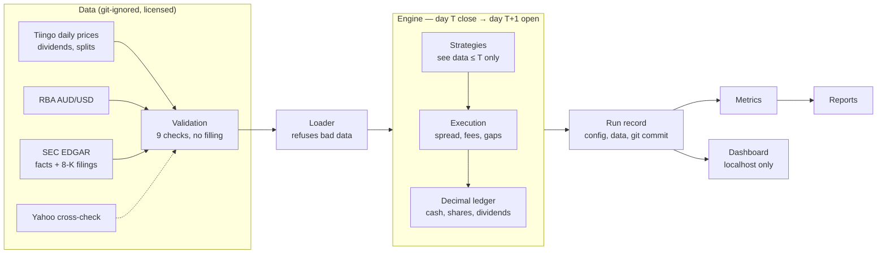
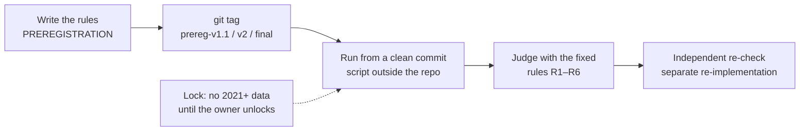
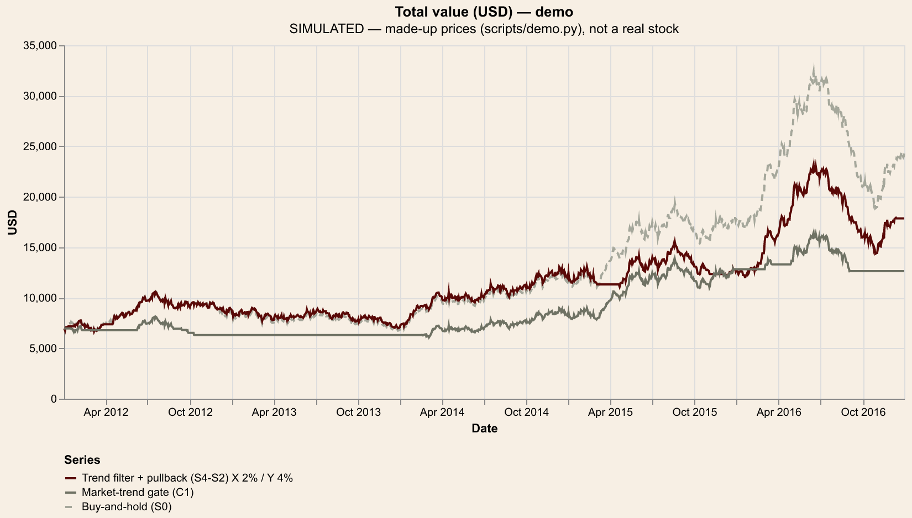
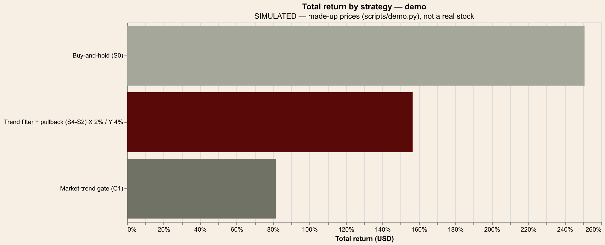

# Quantitative Stock Strategy Research Platform

**Does "sell after a small rise, buy back after a dip" beat simply buying and holding a US stock, after real trading
costs, for an Australian investor with AUD 10,000?** I tested 8 rule-based strategies on 7–8 large US stocks with a
day-by-day simulator. I wrote the rules down and git-tagged them *before* running them, used three separate time
periods, and had the key results re-calculated independently. **The answer is no:** every strategy was rejected on
2017–2020 and again in a one-time final test on 2021–2025.

> All results are **SIMULATED, HISTORICAL** — not a prediction, not financial advice. A well-tested "no" is the result.

## Headline result

| Strategy (benchmark) | Validation 2017–2020: better on | Final test 2021–2025: better on | Final median vs benchmark | Verdict (both periods) |
|---|---|---|---|---|
| Profit target (S1) — sell after +X%, buy back after −Y% (vs buy-and-hold) | 0 of 8 | 2 of 7 | −68.7 pp | **REJECTED** |
| Pullback from peak (S2) (vs buy-and-hold) | 0 of 8 | 2 of 7 | −9.0 pp | **REJECTED** |
| Mean reversion (S3) (vs buy-and-hold) | 3 of 8 | 2 of 7 | −38.2 pp | **REJECTED** |
| Trend filter + profit target (S4-S1) (vs buy-and-hold) | 1 of 8 | 2 of 7 | −15.8 pp | **REJECTED** |
| Trend filter + pullback (S4-S2) (vs buy-and-hold) | 1 of 8 | 0 of 7 | −14.1 pp | **REJECTED** |
| Market-trend gate (C1) (vs buy-and-hold) | 1 of 8 | 2 of 7 | −13.2 pp | **REJECTED** |
| Market-gated pullback (C2) (vs its twin S4-S2) | 1 of 8 | 1 of 7 | −2.1 pp | **REJECTED** |
| Earnings cool-off (E1) (vs its twin S4-S2) | 3 of 8 | 2 of 7 | +0.0 pp | **REJECTED** |

"Better on" = stocks where the strategy's median setting ended with more money than the benchmark (Stake costs).
"pp" = percentage points of total return. Sources: [`reports/RESULTS_SUMMARY.md`](reports/RESULTS_SUMMARY.md),
[`reports/experiments/FINAL_TEST_2021-2025.md`](reports/experiments/FINAL_TEST_2021-2025.md).
**Why it failed:** selling early left the money in cash while prices kept rising; the rules only helped on falling or
flat stocks and in down years, and earlier "winners" did not carry over.

## How it works





## Why the result can be trusted

- **No look-ahead:** a decision at day T's close only sees data up to T and fills at T+1's open; filings count only
  after their acceptance time; tests change all future data and check that no earlier decision moves.
- **Exact money:** cash and shares are `Decimal`, rounded to cents against the investor; dividends after 15% US
  withholding; Stake, IBKR and CommSec cost models plus spread and FX.
- **Rules fixed in advance:** three pre-registrations, each git-tagged before the data it judges was run
  (`prereg-v1.1`, `prereg-v2`, `prereg-final`); 12,272 pre-registered runs from clean commits.
- **Checked twice:** key results (final values and full trade lists) re-calculated to the cent by a separate,
  independent re-implementation; mutation checks (break a
  rule on purpose → tests must fail); **460 automated tests**, incl. end-to-end and error-handling tests.
- **Honest limits:** survivors chosen with hindsight, daily bars, assumed spreads, no tax —
  [`DATA_SOURCES.md` §8](DATA_SOURCES.md), [`reports/RESULTS_SUMMARY.md`](reports/RESULTS_SUMMARY.md) §5.

Details: [RESEARCH_METHODOLOGY.md](RESEARCH_METHODOLOGY.md) · [TESTING.md](TESTING.md) ·
[DATA_SOURCES.md](DATA_SOURCES.md) · [research/FAILED_EXPERIMENTS.md](research/FAILED_EXPERIMENTS.md) ·
[docs/CV_AND_INTERVIEW.md](docs/CV_AND_INTERVIEW.md) · [CHANGELOG.md](CHANGELOG.md)

## Try it in 2 minutes — no data or API key needed

```bash
brew install uv          # once (macOS); see https://docs.astral.sh/uv/ for other systems
uv sync                  # creates the environment (Python 3.13 + packages)
uv run python scripts/demo.py
```

The demo makes up prices for a stock and a market index (fixed seed, with dividends and a 2:1 split) and runs
buy-and-hold, Trend filter + pullback and Market-trend gate through the **real** engine and cost model. It prints a
results table and writes charts to `demo_output/`. Example output (**SIMULATED — made-up prices, not a real stock**):




More pictures, all from the made-up demo data: [drawdown](docs/images/demo_drawdown.png) ·
[dashboard overview](docs/images/dashboard_demo_overview.png) (the verdict tables there are the real published results)
· [dashboard performance](docs/images/dashboard_demo_performance.png) ·
[trade explorer](docs/images/dashboard_demo_trades.png). Dashboard screenshots on the real data are available on
request (the price data's licence doesn't allow publishing them).

## Run the tests and checks

```bash
uv run pytest            # 460 tests; on a fresh clone the tests that need the private data/ folder skip and say why
uv run ruff check . && uv run ruff format --check .
```

More checks (dashboard smoke test, report reproduction, secrets scan): [TESTING.md](TESTING.md). Every script explains
itself with `--help`. Optional package groups: `dashboard`, `crosscheck` (Yahoo), `screenshots`, or all at once with
`uv sync --all-groups`.

## The dashboard (local only)

```bash
uv run python scripts/demo.py                                   # optional: adds the made-up "demo" period
uv run --group dashboard streamlit run src/quant_research/dashboard/app/main.py
```

Open http://localhost:8501. It only views saved results; the period picker shows the **final** test, **validation**,
**development** and (after the demo) **demo** runs. Strategies are shown by name with their ID, e.g.
"Trend filter + pullback (S4-S2)". **Never deploy it:** it shows licensed price data (`.streamlit/config.toml` binds it
to localhost). The Strategy lab runs extra settings through the same engine but labels them **EXPLORATORY — NOT
PRE-REGISTERED**. The Report & export page writes a Markdown report and CSV/YAML/PNG exports with a licence note.

## Using your own data

The real price data is **not included** and cannot be shared. To rebuild it: copy `.env.example` to `.env`, add a
free Tiingo API key (`TIINGO_API_KEY`) and your name + email as `SEC_USER_AGENT` (SEC fair-access rule), then use
the download scripts in `scripts/` (dates and steps: [DATA_SOURCES.md](DATA_SOURCES.md) §10–§13). `.env` and `data/`
are git-ignored.

## Licence

- **Code and documentation:** MIT licence — see [LICENSE](LICENSE).
- **Data is NOT included and NOT covered by the MIT licence:** Tiingo prices are licensed for internal / personal use
  only; RBA exchange rates for personal, non-commercial use with attribution (Reserve Bank of Australia); SEC EDGAR
  filings are public information (source: U.S. Securities and Exchange Commission). Get your own Tiingo key as above.

Author: Maalav Bhagat (Applied Finance + Professional Accounting, Macquarie University). Built with Claude Code under my
direction — how the work was split: [docs/CV_AND_INTERVIEW.md](docs/CV_AND_INTERVIEW.md).
